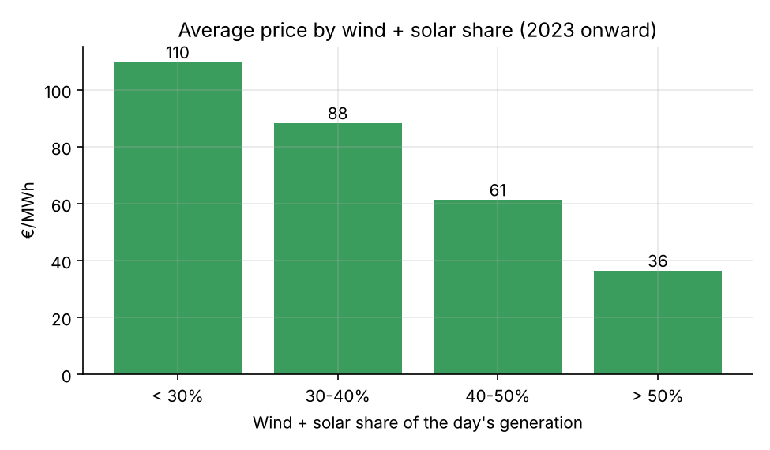
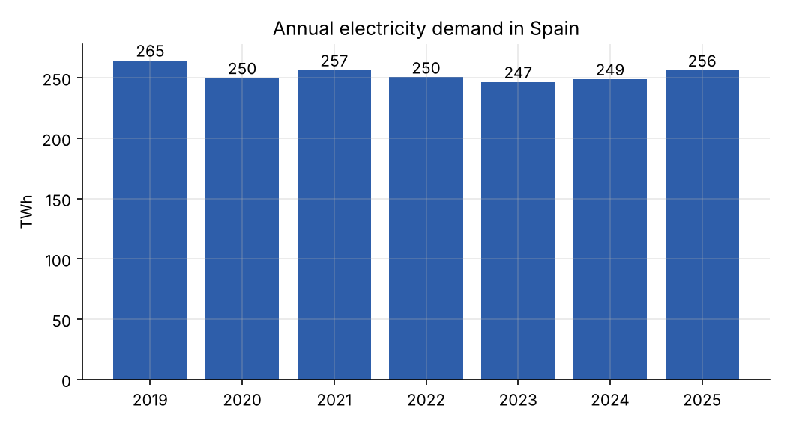
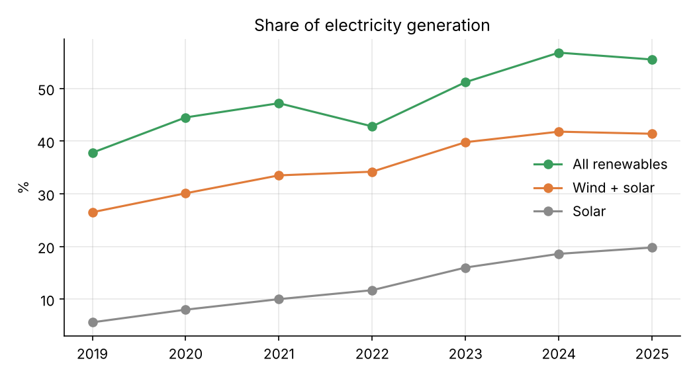
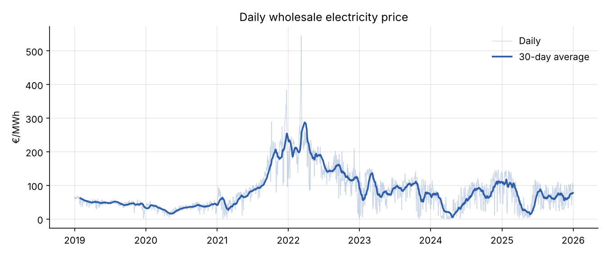
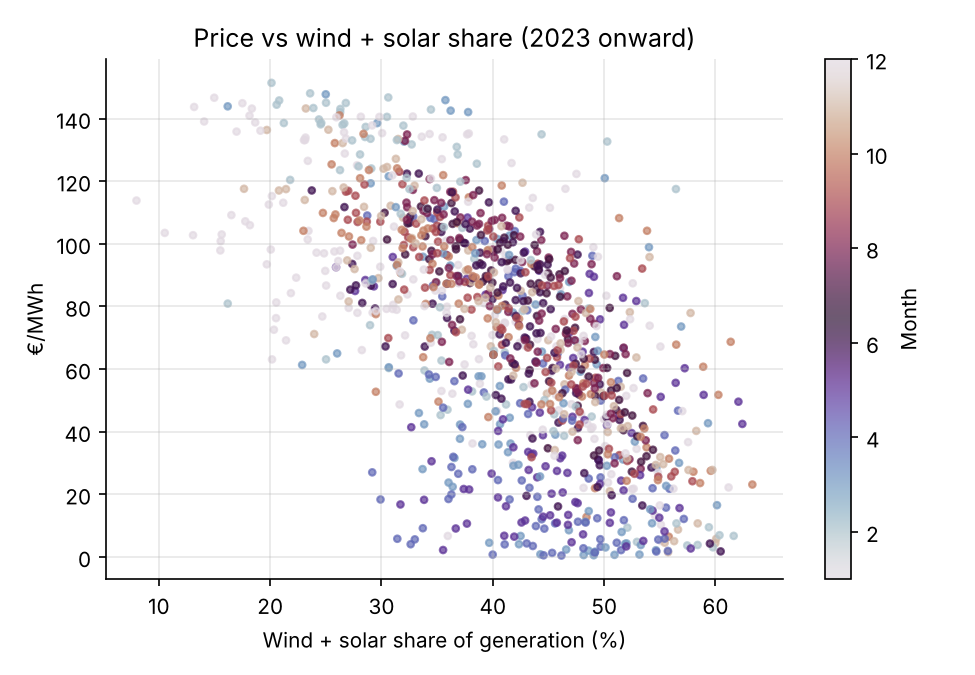
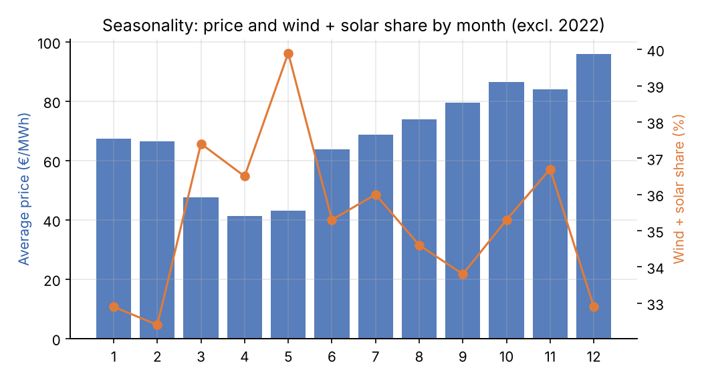

# Spain Electricity Market Analysis (2019–2025)

How have electricity demand, the renewable share and wholesale prices in Spain changed
since 2019, and **how much does wind and solar output lower the price of electricity?**



## Key findings

- **Renewables rose from 37.8% of generation in 2019 to 55.5% in 2025.** Wind + solar went
  from 26.5% to 41.4%, and almost all of the growth came from solar (5.6% → 19.8%).
- **Prices peaked in 2022 at an average of 167.5 €/MWh** during the European gas crisis,
  with a record daily price of 545 €/MWh on 8 March 2022. By 2025 the average was 65.3 €/MWh.
- **Since 2023, days with high wind + solar output are about three times cheaper:**
  109.7 €/MWh on days below 30% wind + solar vs 36.4 €/MWh on days above 50%.
- **Controlling for demand and season, each extra 10 percentage points of wind + solar
  share is associated with a price that is 22.9 €/MWh lower** (linear regression,
  R² = 0.60, 1,096 days, 2023–2025).
- **Near-zero prices are becoming common:** 48 days in 2024 averaged below 10 €/MWh,
  compared with 2 in 2019; 36 of those 48 days fell in March and April.
- **Prices follow a clear seasonal pattern:** cheapest in March–May (41–48 €/MWh),
  most expensive in October–December (84–96 €/MWh), excluding 2022.
- Demand fell 5.5% in 2020 (COVID) and has only recovered to 256 TWh in 2025,
  still below 2019 (265 TWh).

## Data

| Dataset | Source | Resolution |
|---|---|---|
| Electricity demand | Red Eléctrica (REData API) | daily |
| Generation by technology (17 technologies) | Red Eléctrica (REData API) | daily |
| Day-ahead spot price, peninsular market | Red Eléctrica (REData API) | hourly → daily mean |

2,557 days, 1 Jan 2019 – 31 Dec 2025. The price endpoint only serves hourly data in
windows of about 7 days, so prices were downloaded week by week and averaged per day.

## Method

1. **Collection** (`ree_download.py`, `prices_download.py`): REST API calls with
   pagination, retries and resume-on-failure.
2. **Cleaning** (`analysis.py`): reshaped 17 generation series into one tidy daily table;
   removed the API's "total" row to avoid double counting; classified technologies as
   renewable / wind / solar; converted MWh to GWh.
3. **SQL analysis** (`sql/analysis.sql`, run on SQLite): yearly aggregates, CTEs, `LAG`
   window function for year-over-year change, joins, `CASE` bucketing.
   Results: [`output/sql_results.md`](output/sql_results.md)
4. **Regression:** daily price ~ wind + solar share + demand + month dummies,
   on 2023–2025 only, to leave out the 2021–2022 gas-price shock.
5. **Visualisation:** Matplotlib charts below; `data/daily_clean.csv` feeds the Power BI dashboard.

## Charts

| | |
|---|---|
|  |  |
|  |  |
|  | |

## Limitations

- The regression shows association, not causation. **Gas prices**, hydro reservoir levels
  and cross-border flows also drive Spanish prices and are not in this dataset; this is
  why the model is fitted only on 2023 onward, after gas prices stabilised.
- Daily averages hide the intraday pattern: solar pushes midday prices close to zero while
  evening prices stay high.

## Next steps

- Add TTF gas prices and hydro reserves as explanatory variables
- Hourly analysis of the solar "duck curve" and price cannibalisation
- Next-day price forecasting model

## How to run

```bash
pip install requests pandas matplotlib scikit-learn tabulate
python ree_download.py      # demand + generation
python prices_download.py   # prices
python analysis.py          # cleaning, SQL, charts, regression, findings
```

**Tools:** Python (pandas, NumPy, Matplotlib, scikit-learn, requests) · SQL (SQLite) · Power BI
